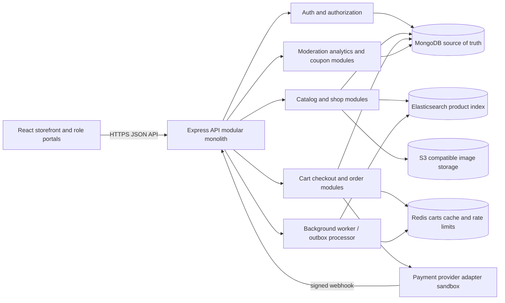

# Market Lane Backend Handoff

**Status:** Test-mode backend and API-connected storefront are implemented; service integration and live-launch gates remain  
**Audience:** Developers continuing the API and connected React portals  
**Scope:** Customer, vendor, and marketplace-admin workflows for the FS-01 capstone

This document records the backend target design. The Express 5 API now implements persistent account, catalog, cart, quote, order, Stripe test checkout/webhook, vendor, admin, review, coupon, audit, upload, and payout workflows, and the React storefront calls those APIs. MongoDB/provider integration is still unverified in this workspace; see [Production-readiness-review.md](Production-readiness-review.md) for the precise test results and release gaps. Treat remaining details here as requirements where the code is not yet exercised or deployed, and update this handoff when implementation decisions change.

## 1. Goals and guiding decisions

- Keep MongoDB the source of truth for accounts, shops, listings, inventory, orders, reviews, coupons, and payment records.
- Organize the API as a modular monolith. One Node.js service is simpler to develop, deploy, and debug for this capstone than independently deployed microservices, while modules keep domain boundaries clear.
- Authenticate people once and authorize every request from their stored role and resource ownership. A frontend role switch is only a demo convenience and never grants access.
- Keep pricing, inventory, coupon validation, commissions, order totals, and payment state calculations on the server. Never trust amounts supplied by the browser.
- Put integrations behind adapters so local development can use explicit substitutes and the capstone can use a payment provider's sandbox without changing order rules.
- Keep demo checkout clearly labeled. Do not configure, request, or use production payment credentials.

## 2. Users, roles, and portal design

There are three user-facing portals. They can share the React application and visual language, but each portal has its own navigation, route guards, API permissions, and data views. The near-black, white, and light-grey Market Lane brand system applies to all portals; vendor and admin work areas should favor clear tables, forms, and status labels over storefront decoration.

| Portal | User | Primary goal | Access rule |
| --- | --- | --- | --- |
| Customer storefront and account | Customer | Discover products, manage a cart, place and track orders, save items, and review delivered purchases | Public catalog is readable without login. Account, saved items, checkout, and personal order data require customer authentication. |
| Vendor workspace | Vendor | Set up a shop, manage its listings and stock, and fulfill its orders | Vendor account must be approved/active. Every listing, stock adjustment, and order action is scoped to the signed-in vendor's shop. |
| Marketplace admin | Admin | Approve sellers, moderate listings, manage platform promotions, monitor orders, payments, and marketplace health | Admin role is assigned through a trusted seed or controlled operator process. Never allow a public sign-up form to select admin. |

### Customer portal

**Pages and functions**

1. **Marketplace / catalog:** Search by product title, product type, description, shop, and category; filter by category, price, availability, and rating; sort by featured, price, or rating. Only published products from active shops are returned.
2. **Product detail:** Show the current listing, seller, price, available quantity, image, description, and published reviews. Add-to-cart requests carry product ID and quantity only.
3. **Cart:** Persist an authenticated customer's cart in Redis for quick access, with a MongoDB fallback if Redis is unavailable. Recalculate prices and availability on every cart read and again at checkout. A guest bag exists only in memory. When a customer signs in, the client merges it into the persisted server cart, revalidating product state and stock; no browser storage is authoritative.
4. **Checkout:** Collect delivery information, validate an active coupon, create a pending order, and start a sandbox payment. Return success only after a verified provider response or webhook confirms the test payment.
5. **Orders:** Show only the customer's orders and their item snapshots, seller allocations, payment/refund state, and allowed status updates. Customers cannot set fulfillment status.
6. **Saved items and reviews:** Save product references per customer. A review is accepted only for a product the customer actually purchased in a delivered order; one review per customer/product is the MVP rule.
7. **Invoices:** Build a printable/PDF invoice from the persisted order snapshot, not current product prices or seller names.

**Customer data ownership:** `GET /api/v1/me`, saved items, cart, addresses, orders, and reviews are always filtered by `req.user.id`. A client-supplied customer ID is ignored for these operations.

### Vendor portal

**Pages and functions**

1. **Application and shop profile:** Submit shop name, owner/contact details, description, and optional business profile fields. New applications start in `pending` status. The vendor can view and edit its own non-sensitive profile fields but cannot approve itself.
2. **Overview:** Show shop revenue derived from paid orders, active products, low-stock warnings, orders needing action, and recent activity. Metrics must be calculated from the authenticated vendor's shop allocation only.
3. **Catalog:** Create, edit, archive, and inspect only the vendor's own products. Product type is a first-class searchable field. Validate positive money values, stock as a non-negative integer, category membership, image ownership, and maximum image size/type.
4. **Images:** Request a short-lived S3-compatible presigned upload URL, upload directly from the browser, then confirm the uploaded object before attaching it to a product. Local development may use a local uploads adapter; it must preserve the same API shape and be documented as non-production.
5. **Orders:** List only order items allocated to the vendor. An order may include multiple vendors, so vendor actions update that vendor's fulfillment sub-order/allocation rather than exposing another seller's items. MVP transitions are `placed → packed → shipped → delivered`; a vendor cannot alter payment state or skip invalid transitions.
6. **Payout view:** Show sandbox transfer/payout state and amounts calculated by the platform. This is a read-only demonstration unless a later approved scope adds vendor payout administration.

**Vendor approval model:** Store a vendor profile/application with `pending`, `active`, `rejected`, or `suspended` status. Only an active vendor can publish products or fulfill new orders. A suspended shop's listings are excluded from public search while historical order records remain intact.

### Admin portal

**Pages and functions**

1. **Overview:** Marketplace-level gross paid sales, commission, order volume, active shops/listings, refunds, and recent operational events. Label test-mode data visibly.
2. **Seller review:** Read applications and approve, reject, or suspend vendor profiles. Record the admin actor, timestamp, and optional reason for every decision.
3. **Catalog moderation:** Search all listings; inspect seller and image references; publish, unpublish, archive, or flag a product. Preserve an audit record for moderation actions.
4. **Order and payment operations:** Inspect full marketplace orders, per-vendor allocations, payment/refund state, provider test references, and webhook failures. Admin can advance or correct fulfillment only through a documented audited action, never by mutating payment state directly.
5. **Coupons:** Create, pause, and expire codes. Server validation owns usage limits, eligible products/categories, active dates, minimum spend, and discount caps. Coupon redemption is reserved/consumed once per successful order.
6. **Audit and system visibility:** Review security-sensitive events, queue/index health, and dependency readiness. Never expose secrets, full payment credentials, password hashes, or provider webhook secrets.

**Admin assignment:** Seed the initial admin using a one-time CLI/bootstrap process that reads secrets from environment variables, or manually promote a known account in the database during local development. Do not create an endpoint that lets any user self-assign admin.

## 3. Target architecture



### Request and module layout

Keep `server/src/app.js` responsible for middleware and route mounting, and `server/src/index.js` responsible for process startup, MongoDB connection, server listening, and graceful shutdown. Split the application into domain modules:

```text
server/src/
  app.js
  index.js
  config/             environment parsing and dependency setup
  middleware/         auth, role checks, request validation, errors, rate limits
  modules/
    auth/             routes, controller, service, validators
    users/
    vendors/
    catalog/
    cart/
    checkout/
    orders/
    payments/
    reviews/
    coupons/
    admin/
    uploads/
  models/             Mongoose schemas and indexes
  services/           Redis, search, storage, payment adapters
  jobs/               outbox delivery, search indexing, cleanup
  utils/              API errors, money helpers, pagination, audit events
```

Route handlers should validate inputs, call a domain service, and shape a response. Domain services own business rules and transactions. Mongoose models should not perform hidden cross-domain workflows. Use shared response/error helpers so validation, authentication, conflict, not-found, and dependency failures have consistent HTTP behavior.

### Dependencies and failure behavior

| Dependency | Responsibility | Source of truth? | Local-development behavior |
| --- | --- | --- | --- |
| MongoDB / Mongoose | Users, vendor profiles, products, stock, orders, payments, reviews, coupons, audit records | Yes | Required for the API; current readiness route reports connection state. |
| Redis | Auth refresh/session revocation data, customer carts, rate limits, short-lived caches | No | Optional fallback for carts/cache to MongoDB or a clearly scoped in-memory adapter. Do not silently pretend persistence survives restarts. |
| Elasticsearch | Product search and faceted filtering | No | MongoDB text-search adapter can support local MVP until Elasticsearch is installed. Search results must still validate current publication/shop status in MongoDB. |
| S3-compatible object storage | Product image bytes; Mongo stores object key and metadata | No | Local filesystem upload adapter may be used for development. Never write base64 images into product documents for the final API. |
| Payment provider | Sandbox payment intent/order and vendor transfer references | No; Mongo order/payment records are our ledger | Fake payment adapter can be used only as an explicitly labeled local demo fallback. Provider sandbox is required before claiming provider integration. |

Elasticsearch and Redis are supporting systems. If a write succeeds in Mongo but indexing/cache invalidation fails, keep the Mongo change, record/retry the event, and report operational health. Do not fail an already committed product update merely because an index is behind. For product-index consistency, write an outbox event with the Mongo change and process it idempotently; a simple post-save enqueue is acceptable only for the first local prototype if the failure/retry limitation is documented.

## 4. Data model and ownership

Store money as integer minor units (for USD, cents) plus a currency code. Avoid floating-point arithmetic for totals, coupons, and commissions. Timestamps use UTC. Normalize email and coupon codes before uniqueness checks.

| Entity | Important fields | Key indexes and rules |
| --- | --- | --- |
| `User` | `email`, `passwordHash`, `displayName`, `roles[]`, `status`, `emailVerifiedAt`, timestamps | Unique normalized email. Hash passwords with bcrypt/argon2; never return `passwordHash`. `roles[]` allows customer and vendor capabilities on one identity; admin is assigned separately. |
| `VendorProfile` | `ownerUserId`, `shopName`, `slug`, `description`, contact details, `status`, moderation fields | Unique owner (MVP one shop per owner) and unique slug. Vendor owns profile and its product documents. Only admin changes moderation status. |
| `Product` | `vendorId`, `name`, `productType`, `description`, `category`, `priceMinor`, `currency`, `stock`, `status`, `imageKeys[]`, rating summary, timestamps | Index `vendorId + status`, category/status, price/status, normalized slug/name. Search index includes product type, name, description, shop, and category. Public results require product `published` and vendor `active`. |
| `Cart` | `userId` or guest token, `items[{productId, quantity}]`, timestamps | Redis key with TTL for quick access; Mongo fallback has unique owner key. Do not treat cached prices as authoritative. |
| `Order` | `customerId`, address snapshot, item snapshots, vendor allocations, subtotal/discount/shipping/total minor units, currency, order status, payment state, coupon snapshot | Unique public order number; indexes by customer/date and status/date. Item snapshots preserve seller, name, SKU, price, quantity, and image key at purchase time. |
| `Payment` | `orderId`, provider, provider payment/order IDs, amountMinor, currency, state, idempotency key, sanitized provider metadata | Unique provider event/payment IDs. Store no PAN/CVV or raw payment method secrets. Webhook handling is idempotent. |
| `Review` | `customerId`, `productId`, `orderId`, `rating`, `body`, moderation status, timestamps | Unique `customerId + productId` for MVP; verify delivered purchased item before create. |
| `Coupon` | normalized `code`, percent/fixed amount, limits, start/end dates, scope, status, usage count | Unique code. Validate and reserve usage transactionally at checkout; consume only on paid order, release on expiration/failure. |
| `AuditEvent` | `actorUserId`, action, resource type/id, safe before/after summary, reason, timestamp | Indexed by resource/date and actor/date. Do not include credentials or sensitive payment data. |

### Order and inventory invariants

- The order is immutable for purchase facts. Status and operational metadata can change, but line item prices, product names, seller identity, totals, and commission snapshots do not change when a listing changes later.
- Compute each line total as `unitPriceMinor * quantity`. Calculate platform commission from eligible item subtotal according to the configured rate, store the result, and derive vendor net allocation as seller gross minus commission and any explicitly defined fee. Keep shipping/tax allocation out of commission unless the capstone requirements later specify otherwise.
- Validate stock against MongoDB at checkout. Decrement/reserve stock atomically within a MongoDB transaction where supported, or use a conditional atomic update and compensating release where the deployment does not support transactions. Prevent two simultaneous checkouts from overselling the same final unit.
- Create a pending order and payment attempt with an idempotency key. Mark it paid only from a verified sandbox API response/webhook. On payment failure or timeout, expire the pending order and release its stock/coupon reservation.
- An order can contain several vendors. Create a vendor allocation/sub-order for each seller, with its own allowed fulfillment status and item subset. Customer/admin order view combines them; each vendor sees only its allocation.
- Webhooks may be retried or arrive out of order. Verify signature, deduplicate provider event IDs, validate expected state transitions, and respond quickly before doing slower follow-up work.

## 5. API contract

All marketplace APIs are versioned under `/api/v1`. Use JSON request/response bodies, ISO-8601 UTC timestamps, minor-unit integers for money, cursor or bounded page pagination, and a shared error shape:

```json
{
  "error": {
    "code": "validation_error",
    "message": "The request could not be accepted.",
    "details": [{ "field": "quantity", "message": "Must be a positive integer." }],
    "requestId": "..."
  }
}
```

Never expose stack traces or raw provider/MongoDB errors in production responses. Public catalog responses can use a `{ data, meta }` envelope; authenticated mutations return the created/updated resource and an appropriate `201`, `200`, or `204` status.

### Authentication and identity

| Method and path | Access | Purpose |
| --- | --- | --- |
| `POST /api/v1/auth/register` | Public | Create customer account; role is always customer. |
| `POST /api/v1/auth/login` | Public, rate limited | Verify credentials and issue short-lived access token plus secure refresh session. |
| `POST /api/v1/auth/refresh` | Refresh cookie/session | Rotate refresh token and revoke its predecessor. |
| `POST /api/v1/auth/logout` | Authenticated | Revoke current refresh session. |
| `GET /api/v1/me` | Authenticated | Current identity, roles, and permitted portal profiles. |
| `PATCH /api/v1/me` | Authenticated | Update safe profile fields only. |

For a browser app, prefer short-lived access tokens held in memory and rotating refresh tokens in `HttpOnly`, `Secure`, `SameSite` cookies, with CSRF protection appropriate to the chosen cookie/CORS setup. If the team chooses bearer tokens instead, document storage and XSS tradeoffs. Use bcrypt or Argon2 for passwords. Validate origins, request sizes, and auth attempts; never store passwords or refresh tokens in browser local storage.

### Customer storefront endpoints

| Method and path | Access | Purpose |
| --- | --- | --- |
| `GET /api/v1/products` | Public | Query: `q`, `category`, `productType`, `minPrice`, `maxPrice`, `sort`, `page`, `limit`. |
| `GET /api/v1/products/:slug` | Public | Published product detail and approved reviews. |
| `GET /api/v1/shops/:slug` | Public | Active shop profile and published products. |
| `GET /api/v1/cart` | Customer | Read cart and refreshed product availability/prices. |
| `PUT /api/v1/cart/items/:productId` | Customer | Set quantity; body `{ "quantity": 2 }`; use zero/delete to remove. |
| `DELETE /api/v1/cart/items/:productId` | Customer | Remove cart line. |
| `POST /api/v1/checkout/quote` | Customer | Reprice cart and validate delivery/coupon without creating a charge. |
| `POST /api/v1/checkout` | Customer | Create pending order and sandbox payment attempt using an idempotency key. |
| `GET /api/v1/orders` | Customer | Paginated current user's orders. |
| `GET /api/v1/orders/:orderNumber` | Owning customer or admin | Order details and vendor allocation statuses. |
| `GET /api/v1/orders/:orderNumber/invoice` | Owning customer or admin | Invoice data or generated PDF stream. |
| `GET /api/v1/me/saved-products` | Customer | Saved products. |
| `PUT /api/v1/me/saved-products/:productId` | Customer | Save product idempotently. |
| `DELETE /api/v1/me/saved-products/:productId` | Customer | Remove saved product. |
| `POST /api/v1/products/:productId/reviews` | Customer | Create review after an eligible delivered order. |

### Vendor endpoints

| Method and path | Access | Purpose |
| --- | --- | --- |
| `POST /api/v1/vendor-applications` | Customer with vendor capability | Apply to open a shop; creates a pending vendor profile. |
| `GET /api/v1/vendor/profile` | Vendor | Read own shop profile and approval state. |
| `PATCH /api/v1/vendor/profile` | Active or pending vendor | Update allowed own shop fields. |
| `GET /api/v1/vendor/products` | Active vendor | List own products, including draft/archived. |
| `POST /api/v1/vendor/products` | Active vendor | Create a draft or published listing, subject to policy. |
| `GET /api/v1/vendor/products/:id` | Owning vendor | Read one own listing. |
| `PATCH /api/v1/vendor/products/:id` | Owning vendor | Update allowed listing fields. |
| `DELETE /api/v1/vendor/products/:id` | Owning vendor | Archive rather than hard-delete a product referenced by orders. |
| `POST /api/v1/vendor/uploads/presign` | Active vendor | Request signed upload for an allowed image type/size. |
| `POST /api/v1/vendor/uploads/confirm` | Active vendor | Verify uploaded object and return image key/metadata. |
| `GET /api/v1/vendor/orders` | Active vendor | Read only own vendor allocations, paginated. |
| `PATCH /api/v1/vendor/orders/:allocationId/status` | Owning vendor | Advance an allowed fulfillment status; audit actor and transition. |
| `GET /api/v1/vendor/analytics/summary` | Active vendor | Own shop's order, revenue, listing, and low-stock summary. |
| `GET /api/v1/vendor/payouts` | Active vendor | Read-only sandbox allocation/transfer history. |

### Admin endpoints

| Method and path | Access | Purpose |
| --- | --- | --- |
| `GET /api/v1/admin/overview` | Admin | Marketplace totals and dependency/index health summary. |
| `GET /api/v1/admin/vendor-applications` | Admin | Filter pending and historical applications. |
| `PATCH /api/v1/admin/vendors/:vendorId/status` | Admin | Approve/reject/suspend with reason and audit event. |
| `GET /api/v1/admin/products` | Admin | Search/filter all listings and moderation states. |
| `PATCH /api/v1/admin/products/:productId/status` | Admin | Publish/unpublish/archive/flag a listing with audit event. |
| `GET /api/v1/admin/orders` | Admin | Search marketplace orders and allocation/payment status. |
| `GET /api/v1/admin/payments` | Admin | Inspect sanitized sandbox payments and webhook processing status. |
| `POST /api/v1/admin/coupons` | Admin | Create coupon with server-validated rules. |
| `PATCH /api/v1/admin/coupons/:couponId` | Admin | Pause, resume, or update permitted coupon fields. |
| `GET /api/v1/admin/audit-events` | Admin | Paginated security and moderation history. |
| `POST /api/v1/webhooks/payments/:provider` | Provider signature | Verify and process provider events idempotently; no browser auth. |

### API security rules

- Apply authentication first, then role/capability checks, then ownership checks. Avoid trusting route IDs to establish ownership.
- Validate with a schema library such as Zod or Joi; reject unknown fields on sensitive mutations.
- Allowlist sortable/searchable fields and clamp page size. Do not pass raw client query objects to MongoDB or Elasticsearch.
- Sanitize text, use parameterized/structured queries, and guard against NoSQL operator injection.
- Configure CORS for the known client origin, secure cookie attributes, Helmet/security headers, body-size limits, and rate limiting on login, checkout, reviews, uploads, and coupon validation.
- Verify upload file type by inspecting content, restrict size, generate random object keys, and prevent executable/public HTML uploads.
- Avoid logging passwords, authorization headers, email verification/reset tokens, full addresses, or provider secrets. Include a request ID in logs and errors.

## 6. Search, image storage, and cache details

### Product search

MongoDB product records define the canonical searchable fields: `name`, `productType`, `description`, `category`, and shop name. Elasticsearch indexes only published products and supports phrase matching, product-type synonyms (for example, `cup`, `cups`, `mug`, `mugs`, and `drinkware`), filters, and sort options. Keep synonyms in a shared documented search configuration so frontend helper aliases and backend results do not diverge. Product-type synonyms are search behavior, not automatic category changes.

When Elasticsearch is enabled, use a versioned index and a reindex command. A background job consumes product/shop outbox events. Until then, use a documented MongoDB text-search adapter. Search must not expose an inactive seller or unpublished product because an index event is delayed; validate result IDs against MongoDB or promptly remove stale IDs.

### Product images

The browser requests a presigned `PUT`, uploads bytes directly to an S3-compatible bucket, and confirms the object key with the API. The API validates ownership, allowed MIME type, size, and object key prefix. Mongo stores `key`, content type, dimensions if available, and alt text; it does not store long-lived signed URLs. Generate view URLs at response time or use a public CDN policy appropriate for public product imagery. Do not commit secrets or uploaded customer data to the repository.

### Redis

Use Redis for carts, refresh-session revocation/rotation metadata if selected, rate limiting, and short-lived non-authoritative caches. Set TTLs and namespaced keys. Invalidate product/shop cache on relevant writes. Orders and payment state are always persisted in MongoDB; Redis failure must never lose a completed order.

## 7. Payment and checkout lifecycle

1. Customer requests a checkout quote. Server loads product and vendor data from MongoDB, checks active/published state and stock, recalculates totals, and validates the coupon.
2. Customer submits checkout with address, coupon code, and an idempotency key. Server re-quotes, reserves inventory/coupon usage, snapshots line items, commissions and vendor allocations, and creates a `pending_payment` order.
3. Payment adapter creates a sandbox payment intent/order for the exact server total. Return only provider-safe client confirmation details.
4. Browser completes provider sandbox flow. A verified provider response or signed webhook moves the payment to paid and order/allocation statuses to `placed`; persist unique provider IDs and audit relevant transitions.
5. Create sandbox vendor transfers/allocations if the chosen provider and sandbox account support it. Record each transfer separately and clearly label it test mode. If true split settlement is unavailable in sandbox, show the platform-calculated allocation and document the gap rather than claiming money was transferred.
6. Payment failure, timeout, or duplicate events are handled idempotently. Release stock and coupon reservations when the payment attempt is definitively failed or expired. Never infer payment success from a frontend redirect.

The `PaymentProvider` adapter should expose a small interface such as `createPayment`, `verifyWebhook`, `createTransfer` (if supported), and `refund`. Implement one provider for the capstone; keep the alternative provider as a future adapter, not half-implemented branching inside order logic. Store only provider IDs, state, amounts, currency, and sanitized metadata. Production/live mode is out of scope.

## 8. Errors, observability, and readiness

Use appropriate status codes: `400` validation, `401` unauthenticated, `403` forbidden, `404` missing/inaccessible resource, `409` stock/state/idempotency conflict, `422` domain validation when useful, `429` rate limited, and `500/503` internal/dependency failures. Keep `/health` as process liveness. Expand `/ready` to report required dependencies without leaking connection strings. Make optional dependencies clearly labeled as degraded when their local adapter is in use.

Log structured request ID, route, duration, result code, and safe actor/resource IDs. Add audit events for seller approval, product moderation, coupon changes, order status corrections, and payment state changes. Background jobs should expose last-success time, failure count, and retry/dead-letter state to admins or local logs.

## 9. Environment and setup

Node.js 20+ and npm are already available. The current `server/package.json` includes Express, Mongoose, and dotenv. Before implementing the full architecture, choose and document versions for validation, password hashing, auth/JWT or session tooling, and test libraries.

Install/configure in phases:

1. **Required now:** MongoDB Community locally or MongoDB Atlas URI; install server dependencies with `cd server; npm install`; copy `server/.env.example` to `server/.env` and configure `MONGODB_URI` and a strong development-only auth secret.
2. **Auth foundation:** Add validation and password-hashing packages; add a test runner and HTTP test helper. Keep all secrets in `.env`, never in source control.
3. **Optional service setup as features arrive:** Redis for carts/rate limits, Elasticsearch for full catalog search, and an S3-compatible bucket (or local upload adapter) for images.
4. **Commerce integration:** Create a Stripe Connect or Razorpay sandbox account and sandbox keys only when implementing payment. Confirm sandbox transfer capabilities before representing a flow as split payment.

Docker Desktop is optional if the developer prefers containers. Redis, Elasticsearch, S3, and payment credentials are not prerequisites for the initial Mongo/auth/catalog milestone. Add all new variables to `.env.example` with safe placeholders and keep it synchronized with this handoff and README.

Current backend startup:

```powershell
cd server
Copy-Item .env.example .env
npm install
npm run dev
```

The server listens on port 4000 by default. Check `/health` for process liveness and `/ready` for MongoDB readiness. The frontend and backend currently run separately; configure API base URL and CORS explicitly when connecting them.

## 10. Implementation sequence and completion criteria

### Milestone A: API structure and auth

- Add configuration validation, modular route mounting, request ID/security middleware, schema validation, shared errors, and consistent shutdown.
- Add User model, password hashing, registration/login/refresh/logout, `/me`, and seed-only admin bootstrap.
- Add role and ownership middleware; document local environment setup.

**Done when:** duplicate email, invalid credentials, expired/revoked token, customer/vendor/admin permission boundaries, and safe error responses are covered by automated tests.

### Milestone B: shops and catalog

- Add vendor application/review lifecycle and shop profile.
- Add Product model, vendor-owned CRUD, publish/archive behavior, category/product-type validation, image adapter, and public listing/detail routes.
- Add product indexes and Mongo search adapter; optionally configure Elasticsearch and outbox/reindex process.

**Done when:** public search returns active-shop published listings, vendor A cannot access vendor B's product IDs, and all price/image/product-type rules are validated.

### Milestone C: cart and checkout

- Add cart service and Redis adapter/fallback; quote endpoint; inventory and coupon reservation rules; Order, allocation, and Payment models.
- Connect one payment provider sandbox adapter, webhook signature verification, idempotency, and failure compensation.

**Done when:** duplicate checkout is safe, total derives from server data, concurrent last-item checkouts cannot oversell, webhook retries do not duplicate state, and no production payment path exists.

### Milestone D: fulfillment, reviews, coupons, admin, and frontend connection

- Add vendor allocations/order transitions, customer order history/invoice data, reviews, coupons, admin moderation/analytics/audit endpoints.
- Replace frontend localStorage persistence behind API service modules, add loading/error/empty states, and keep demo mode messaging where provider/API substitutes remain.

**Done when:** each portal's endpoints enforce the ownership matrix, seed data supports a complete demo, and the README can take a new developer from setup through a verified customer/vendor/admin flow.

### Release gates

- Automated API tests cover auth, role boundaries, product ownership, search synonyms, cart totals, stock conflicts, coupons, order transitions, webhook signatures/retries, and vendor isolation.
- A documented manual end-to-end check covers register/login, seller application/approval, listing creation/image upload, product search, checkout in test mode, fulfillment, delivered review, and admin analytics.
- `/ready` accurately reports required service state. Logs contain no secrets. `.env.example`, README, this handoff, and architecture diagrams match the shipped behavior.
- Demo screenshots/recording identify all provider actions as test mode; no live charge or real transfer is made.

## 11. Decisions still to confirm during implementation

These are implementation choices, not blockers to starting the backend:

- Which single payment provider sandbox to implement first (Stripe Connect or Razorpay) and whether its sandbox supports the desired vendor transfer demonstration.
- Whether MongoDB will be local Community Server, Atlas, or a local Docker container.
- Whether the local upload adapter is sufficient during development or an S3-compatible development bucket is available.
- Whether guest checkout is required. The recommended MVP requires a customer account for saved orders and checkout; guest cart may be held locally until login.
- Shipping/tax remain simplified demonstration values unless the capstone owner explicitly expands scope.

## 12. Frontend integration notes

- The current React preview stores products, carts, accounts, and orders in browser local storage. Those local records are demo-only and should not be migrated as trusted server data.
- Create a small `client/src/api/` layer for `auth`, `catalog`, `cart`, `checkout`, `orders`, `vendor`, and `admin`; keep fetch/error/token handling out of view components.
- Map portal navigation to authenticated capability state returned by `/me`. A visible portal switch may help demos, but the server remains authoritative.
- Use product `productType` and synonym-expanded search on both sides. Keep client-side synonyms as a responsive convenience; backend search remains the security and data result authority.
- Do not remove test-mode labels until the deployed provider environment and behavior are independently verified.
